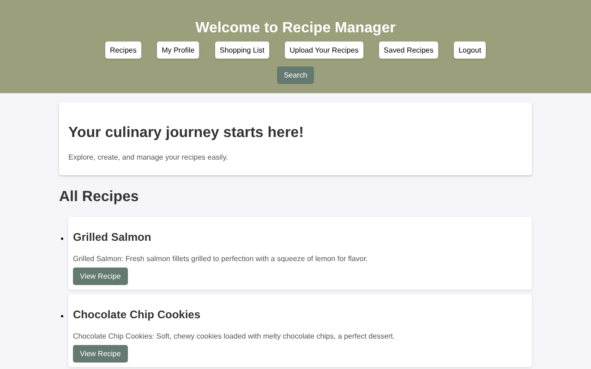
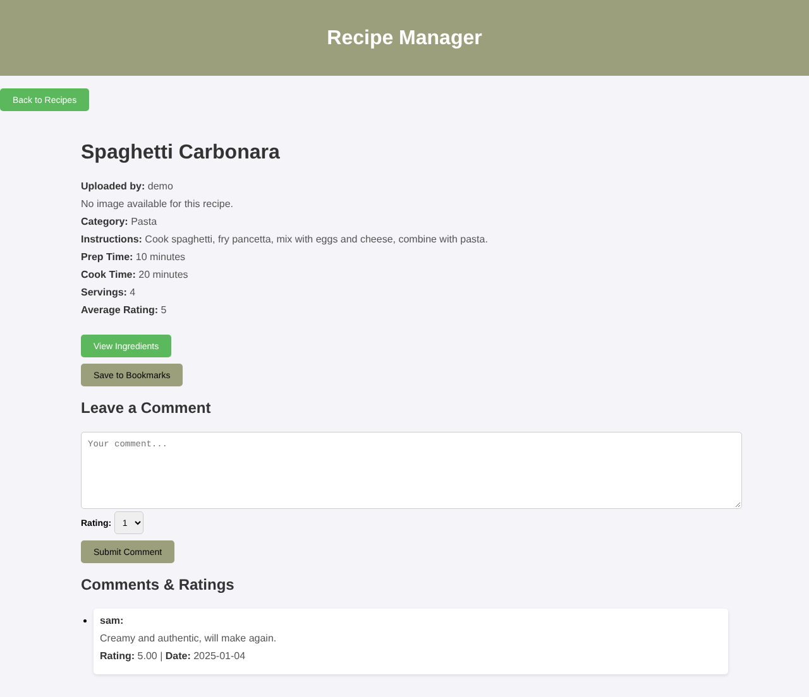
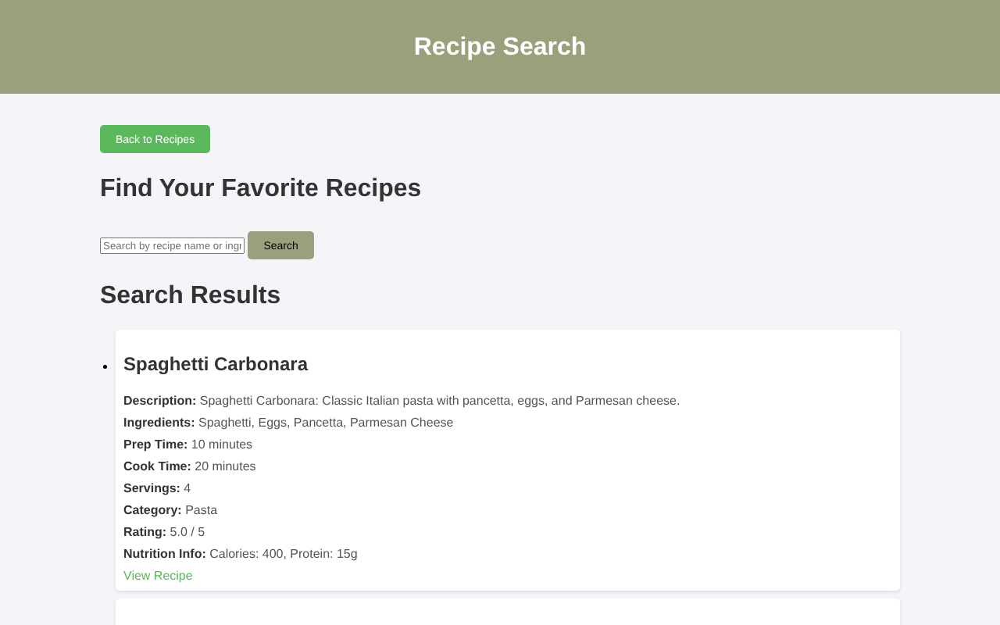
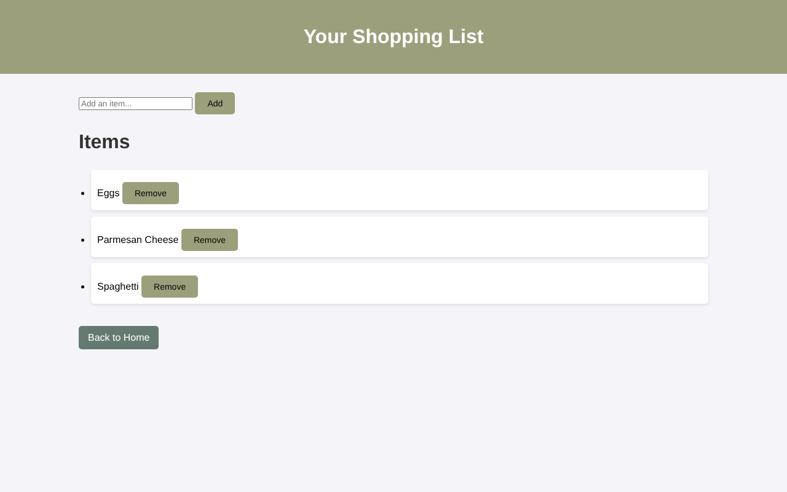

# Recipe Management Website

A recipe management web application built with plain PHP, HTML, CSS and MySQL. Users can browse, upload, rate and bookmark recipes, search by name, ingredient or category, and keep a personal shopping list.



## Features

- **Authentication:** sign up, log in and log out, with passwords stored as secure hashes
- **Recipes:** browse all recipes and view full details (instructions, prep/cook time, servings, nutrition)
- **Ingredients:** view the ingredient list and quantities for each recipe
- **Ratings & reviews:** rate recipes from 1 to 5, leave comments, and delete your own comments
- **Bookmarks:** save recipes and view them on the Saved Recipes page
- **Search:** find recipes by title, ingredient or category
- **Upload & manage:** upload your own recipes with an image and ingredients; edit or delete them from your profile
- **Shopping list:** keep a personal list of ingredients to buy
- **Account:** change your password from the profile page

| Recipe details | Search | Shopping list |
|---|---|---|
|  |  |  |

## Database design

The MySQL database (`recipe_db.sql`) has 8 related tables:

| Table | Purpose |
|---|---|
| `user` | Accounts (username and hashed password) |
| `recipe` | Recipe details, linked to the user who uploaded it |
| `ingredients` | Ingredient name, quantity and unit |
| `menu` | Links recipes to their ingredients (many-to-many) |
| `rate` | Ratings and comments, linked to a user and a recipe |
| `bookmarks` | Recipes saved by each user (many-to-many) |
| `shoppinglist` | One shopping list per user |
| `items` | Items in each shopping list |

Foreign keys keep the data consistent, and every query that includes user input runs as a prepared statement to protect against SQL injection.

## Tech stack

- PHP (plain, no framework) with MySQLi
- HTML & CSS
- MySQL / MariaDB (via XAMPP and phpMyAdmin)

## How to run it locally (XAMPP)

1. Install [XAMPP](https://www.apachefriends.org/) and start **Apache** and **MySQL**.
2. Copy this project folder into XAMPP's `htdocs` folder, e.g. `C:\xampp\htdocs\Recipe-Management-Website`.
3. Open phpMyAdmin (http://localhost/phpmyadmin), create a database called `recipe_db`, and import `recipe_db.sql`.
4. Copy `config/db.example.php` to `config/db.php`. The defaults match a standard XAMPP install (user `root`, no password); change them if your setup is different.
5. Open http://localhost/Recipe-Management-Website in your browser.

**Demo accounts** (included in the sample data):

| Username | Password |
|---|---|
| `demo` | `demo123` |
| `sam` | `sam123` |

Or sign up for a new account.

## Project structure

```
├── config/
│   └── db.example.php     # Database connection template (copy to db.php)
├── images/                # Uploaded recipe images
├── screenshots/           # Screenshots used in this README
├── index.php              # Login page
├── signup.php / login.php / logout.php
├── recipes.php            # All recipes (home page after login)
├── recipe_detail.php      # Recipe details, ratings, comments, bookmarking
├── ingredients.php        # Ingredients for a recipe
├── search.php             # Search by title, ingredient or category
├── upload_recipe.php      # Upload a new recipe
├── recipe_update.php      # Edit your recipe
├── profile.php            # Your recipes and password change
├── saved_recipes.php      # Bookmarked recipes
├── shopping_list.php      # Personal shopping list
├── styles.css
└── recipe_db.sql          # Database schema and sample data
```
